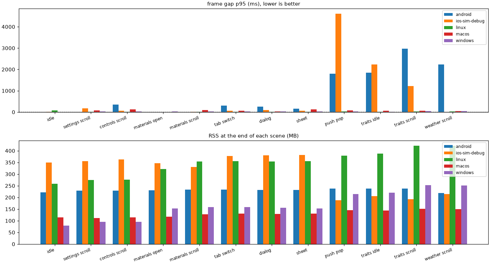
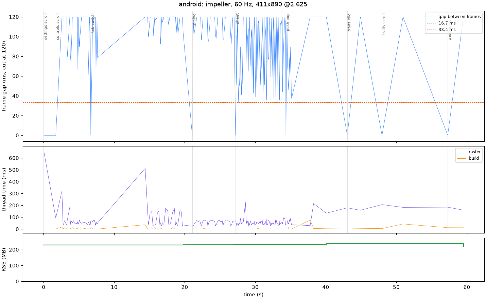
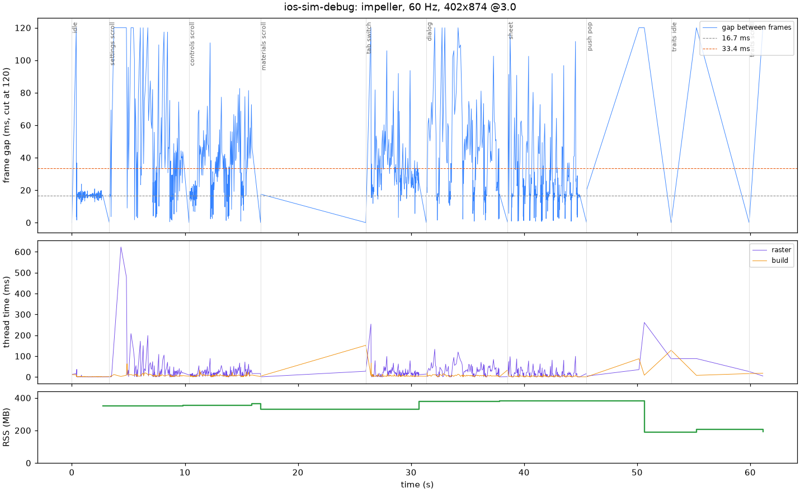
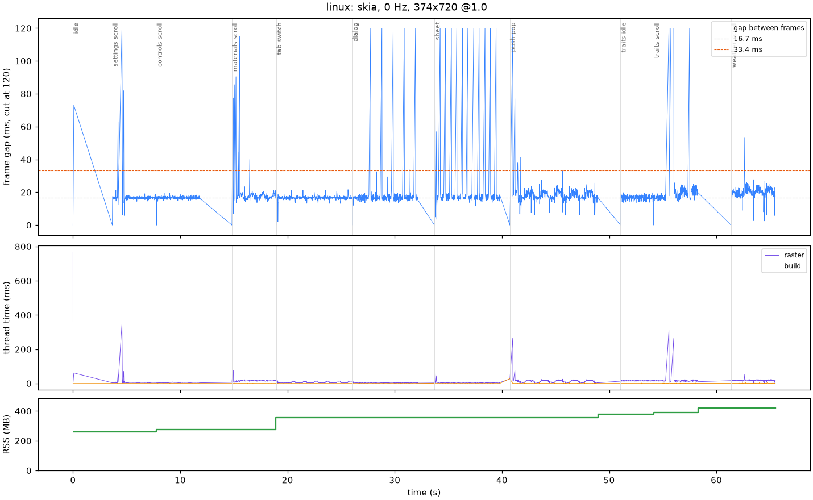
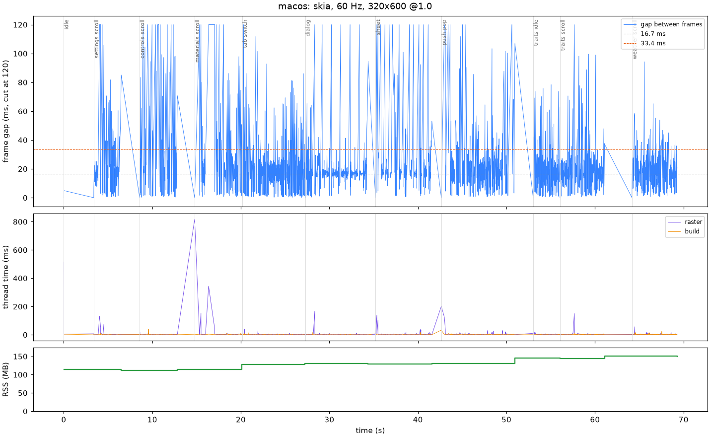
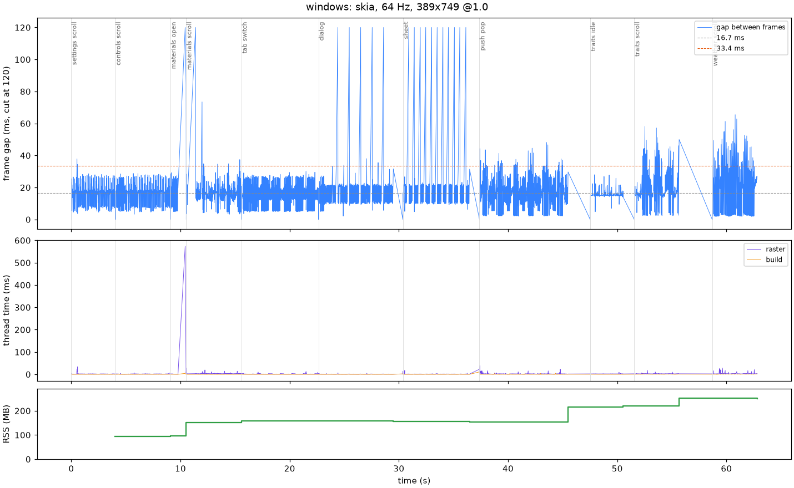

# hyper_showcase performance

CI runners have no real GPU unless noted: Windows and Linux render in software, the Android emulator uses SwiftShader and the iOS simulator runs a debug build. Read these for regressions, crashes and the relative weight of scenes, not as what a phone would do.

## android

android, impeller, 60 Hz, 411x890 @2.625

| scene | frames | fps | gap p50 | gap p95 | gap max | >33 ms | raster p95 | RSS MB |
|---|---|---|---|---|---|---|---|---|
| idle | 0 | 0 | 0.0 | 0.0 | 0.0 | 0 | 0.0 | 222 |
| settings scroll | 1 | 0 | 0.0 | 0.0 | 0.0 | 0 | 666.1 | 229 |
| controls scroll | 26 | 5 | 178.0 | 351.1 | 877.4 | 25 | 184.3 | 229 |
| materials open | 0 | 0 | 0.0 | 0.0 | 0.0 | 0 | 0.0 | 231 |
| materials scroll | 0 | 0 | 0.0 | 0.0 | 0.0 | 0 | 0.0 | 234 |
| tab switch | 39 | 6 | 158.6 | 310.6 | 6746.0 | 38 | 174.3 | 234 |
| dialog | 34 | 5 | 196.3 | 251.7 | 418.7 | 33 | 75.3 | 232 |
| sheet | 79 | 12 | 89.6 | 154.9 | 292.1 | 77 | 81.7 | 232 |
| push pop | 16 | 2 | 65.9 | 1799.3 | 2629.4 | 15 | 133.8 | 238 |
| traits idle | 2 | 1 | 1846.1 | 1846.1 | 1846.1 | 1 | 179.2 | 238 |
| traits scroll | 2 | 0 | 2978.5 | 2978.5 | 2978.5 | 1 | 206.3 | 238 |
| weather scroll | 2 | 0 | 2229.2 | 2229.2 | 2229.2 | 1 | 184.5 | 219 |

## ios-sim-debug

ios, impeller, 60 Hz, 402x874 @3.0

| scene | frames | fps | gap p50 | gap p95 | gap max | >33 ms | raster p95 | RSS MB |
|---|---|---|---|---|---|---|---|---|
| idle | 143 | 46 | 16.6 | 19.4 | 391.3 | 2 | 1.5 | 350 |
| settings scroll | 126 | 20 | 32.9 | 173.9 | 626.2 | 61 | 150.4 | 355 |
| controls scroll | 185 | 33 | 26.3 | 68.7 | 110.7 | 69 | 47.3 | 363 |
| materials open | 0 | 0 | 0.0 | 0.0 | 0.0 | 0 | 0.0 | 347 |
| materials scroll | 2 | 0 | 17.5 | 17.5 | 17.5 | 0 | 16.4 | 330 |
| tab switch | 132 | 20 | 29.9 | 68.6 | 451.2 | 46 | 46.8 | 377 |
| dialog | 165 | 25 | 34.9 | 101.7 | 192.9 | 82 | 69.0 | 380 |
| sheet | 271 | 42 | 17.4 | 61.3 | 116.3 | 43 | 43.5 | 382 |
| push pop | 5 | 1 | 472.2 | 4615.5 | 4615.5 | 2 | 261.4 | 188 |
| traits idle | 2 | 1 | 2236.8 | 2236.8 | 2236.8 | 1 | 88.1 | 205 |
| traits scroll | 2 | 0 | 1217.2 | 1217.2 | 1217.2 | 1 | 26.1 | 193 |
| weather scroll | 0 | 0 | 0.0 | 0.0 | 0.0 | 0 | 0.0 | 214 |

## linux

linux, skia, 0 Hz, 374x720 @1.0

| scene | frames | fps | gap p50 | gap p95 | gap max | >33 ms | raster p95 | RSS MB |
|---|---|---|---|---|---|---|---|---|
| idle | 3 | 1 | 73.0 | 73.0 | 73.0 | 1 | 767.4 | 258 |
| settings scroll | 222 | 53 | 16.7 | 18.0 | 350.8 | 4 | 7.1 | 274 |
| controls scroll | 244 | 58 | 16.6 | 17.9 | 19.5 | 0 | 6.8 | 276 |
| materials open | 0 | 0 | 0.0 | 0.0 | 0.0 | 0 | 0.0 | 321 |
| materials scroll | 215 | 51 | 17.4 | 20.9 | 115.0 | 7 | 19.1 | 354 |
| tab switch | 428 | 66 | 16.7 | 18.1 | 21.6 | 0 | 13.7 | 356 |
| dialog | 318 | 50 | 16.7 | 19.1 | 165.6 | 6 | 5.8 | 354 |
| sheet | 261 | 41 | 16.7 | 19.8 | 181.8 | 13 | 6.2 | 355 |
| push pop | 443 | 52 | 17.3 | 22.6 | 269.1 | 5 | 20.6 | 379 |
| traits idle | 186 | 60 | 16.6 | 18.6 | 19.8 | 0 | 17.9 | 388 |
| traits scroll | 178 | 42 | 18.1 | 24.2 | 312.0 | 4 | 20.8 | 421 |
| weather scroll | 206 | 48 | 20.0 | 24.6 | 53.5 | 1 | 22.0 | 422 |

## macos

macos, skia, 60 Hz, 320x600 @1.0

| scene | frames | fps | gap p50 | gap p95 | gap max | >33 ms | raster p95 | RSS MB |
|---|---|---|---|---|---|---|---|---|
| idle | 2 | 1 | 5.0 | 5.0 | 5.0 | 0 | 514.8 | 114 |
| settings scroll | 127 | 27 | 17.2 | 70.7 | 159.8 | 25 | 3.4 | 112 |
| controls scroll | 119 | 25 | 17.5 | 129.5 | 292.3 | 31 | 4.2 | 114 |
| materials open | 0 | 0 | 0.0 | 0.0 | 0.0 | 0 | 0.0 | 117 |
| materials scroll | 149 | 30 | 17.4 | 97.8 | 692.6 | 30 | 5.7 | 128 |
| tab switch | 345 | 53 | 17.5 | 63.6 | 133.7 | 46 | 4.1 | 130 |
| dialog | 344 | 53 | 16.9 | 38.1 | 195.2 | 23 | 3.6 | 129 |
| sheet | 220 | 33 | 17.7 | 122.3 | 277.8 | 35 | 10.4 | 130 |
| push pop | 325 | 38 | 17.5 | 70.6 | 438.1 | 50 | 10.0 | 145 |
| traits idle | 156 | 50 | 16.2 | 60.9 | 78.4 | 18 | 5.3 | 144 |
| traits scroll | 250 | 52 | 17.0 | 58.0 | 154.6 | 23 | 4.8 | 151 |
| weather scroll | 268 | 52 | 16.9 | 40.8 | 94.3 | 32 | 5.5 | 150 |

## windows

windows, skia, 64 Hz, 389x749 @1.0

| scene | frames | fps | gap p50 | gap p95 | gap max | >33 ms | raster p95 | RSS MB |
|---|---|---|---|---|---|---|---|---|
| idle | 0 | 0 | 0.0 | 0.0 | 0.0 | 0 | 0.0 | 79 |
| settings scroll | 257 | 59 | 16.9 | 27.1 | 37.9 | 2 | 2.4 | 95 |
| controls scroll | 321 | 74 | 17.1 | 27.1 | 28.8 | 0 | 2.5 | 96 |
| materials open | 46 | 50 | 20.4 | 29.2 | 653.1 | 2 | 2.3 | 152 |
| materials scroll | 276 | 64 | 15.3 | 28.2 | 724.9 | 6 | 4.8 | 158 |
| tab switch | 448 | 69 | 15.1 | 26.9 | 30.1 | 0 | 3.5 | 158 |
| dialog | 377 | 59 | 19.9 | 26.2 | 172.3 | 9 | 1.7 | 155 |
| sheet | 273 | 43 | 20.2 | 26.7 | 192.1 | 11 | 1.9 | 153 |
| push pop | 485 | 57 | 16.9 | 34.1 | 48.2 | 34 | 3.9 | 215 |
| traits idle | 192 | 61 | 15.1 | 21.5 | 28.0 | 0 | 2.6 | 220 |
| traits scroll | 222 | 50 | 15.9 | 43.5 | 58.2 | 26 | 3.6 | 253 |
| weather scroll | 209 | 48 | 18.4 | 49.4 | 65.5 | 43 | 11.7 | 251 |

From f5847a8fe36d5845d40a6b6352a5f7b5a76a0acd, run 41294129556.
